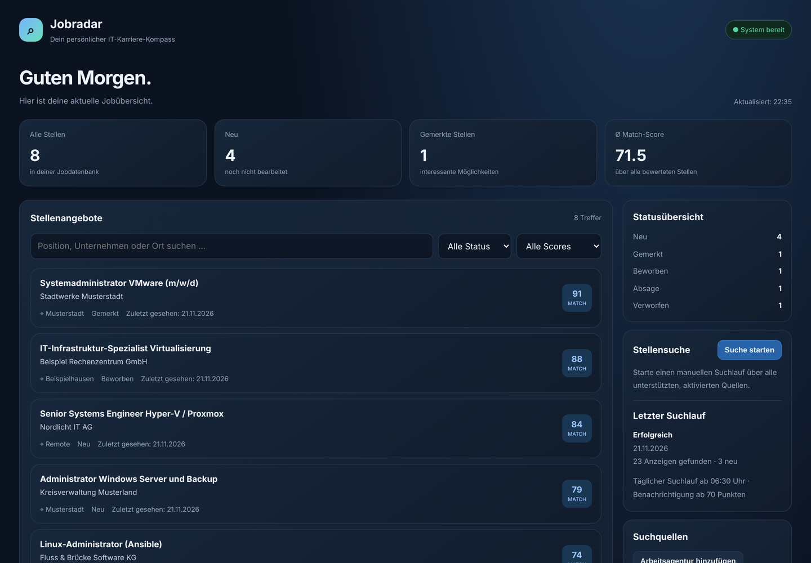
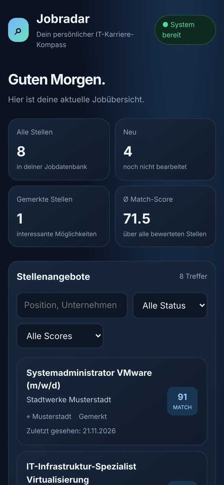

# Jobradar – zentrale Plattform

Dieses private Repository bündelt die bisherigen Jobradar-Bestandteile und hält die bestehenden Betriebsarten während der Konsolidierung getrennt.

<p>
  
  
</p>

<sub>Dashboard des eigenständigen Dienstes, mit erfundenen Beispielstellen.</sub>

## Bestandteile

- **Home-Assistant-Integration** unter `custom_components/jobradar/` (bisheriges HACS-/Custom-Component-Projekt).
- **Eigenständiger Jobradar-Dienst** unter `jobradar/` (FastAPI, SQLite und Home-Assistant-Add-on).
- **Dokumentation** unter `docs/`.

## Zielarchitektur und Grenzen

Das langfristige Ziel ist eine zentrale, lokal betriebene Jobradar-Anwendung. Der Dienst läuft dafür als eigenständiger Docker-Container auf einem Heimserver (siehe [deploy/standalone](deploy/standalone/README.md)); Home Assistant ist nur noch für Benachrichtigungen angebunden. Die bestehende Home-Assistant-Integration und der neue eigenständige Dienst teilen während der Konsolidierung zunächst weder Laufzeit noch Datenbank.

Die Bewertungslogik der alten Integration und des neuen Dienstes unterscheidet sich. Sie wird nicht blind vereinheitlicht; eine fachliche Entscheidung und Regressionstests sind Voraussetzung.

## Projektstruktur

- `custom_components/jobradar/`: bisherige Home-Assistant-Integration.
- `jobradar/app/`: FastAPI-Anwendung und SQLite-Persistenz.
- `jobradar/tests/`: Tests des eigenständigen Dienstes.
- `tests/`: Tests der Home-Assistant-Integration.
- `docs/`: Architektur- und Betriebsdokumentation.

## Ohne Home Assistant OS (Docker, z. B. Unraid)

Der Dienst läuft auch als eigenständiger Container, mit eigener Anmeldung statt der von Home Assistant.
Einrichtung und Umzug stehen in [deploy/standalone](deploy/standalone/README.md).

## Entwicklung und Tests

### Eigenständiger Dienst

Im Verzeichnis `jobradar`:

```bash
python -m pip install -r requirements.txt -r requirements-dev.txt
pytest -q
```

### Home-Assistant-Integration

Im Repository-Root:

```bash
python -m pip install -r requirements_test.txt ruff
python tools/check_versions.py
ruff check custom_components/jobradar tools/check_versions.py tests/test_api.py tests/test_bund.py tests/test_integration.py tests/test_pay.py tests/test_scoring.py
ruff format --check custom_components/jobradar tools/check_versions.py tests/test_api.py tests/test_bund.py tests/test_integration.py tests/test_pay.py tests/test_scoring.py
pytest -q
```

GitHub Actions prüft die Integration, den eigenständigen Dienst, den Secret-Scan und den ARM64-Add-on-Build.

## Home Assistant Green

Der eigenständige Dienst ist für Home Assistant OS auf ARM64 vorgesehen. Er verwendet FastAPI, SQLite und Home-Assistant-Ingress. Seine Datenbank liegt persistent unter `/data/jobradar.db`.

Die bestehende Integration bleibt bis zur abgeschlossenen Migration verfügbar. Es erfolgt keine automatische Änderung an vorhandenen Home-Assistant-Installationen oder Datenbanken.

## Datenschutz

Das Repository bleibt privat. Suchprofil, konkrete Stellen, Notizen, Lernregeln und Laufdaten gehören nicht in Quelldateien oder Commits. Keine Zugangsdaten, Tokens oder privaten Schlüssel einchecken.

## Datenmigration und Sicherheit

- Daten aus dem bisherigen Jobradar werden über den Import übernommen (siehe [docs/import.md](docs/import.md)); der Import läuft zuerst als Probelauf.
- Die bestehende Jobradar-Integration wird nicht automatisch deinstalliert oder ersetzt.
- Test- und Produktionsdatenbanken bleiben getrennt.
- Keine Installation, Aktivierung oder Migration auf dem produktiven Home Assistant ohne ausdrückliche Freigabe.

## Konsolidierungsstatus

Die bisherige Integration wurde in diesen Konsolidierungszweig übernommen. Die CI-Prüfungen einschließlich ARM64-Add-on-Build sind erfolgreich. Noch ausstehend sind die abschließende Konflikt- und Konsolidierungsprüfung sowie eine fachliche Entscheidung zum Umgang mit den unterschiedlichen Scoring-Modellen.
